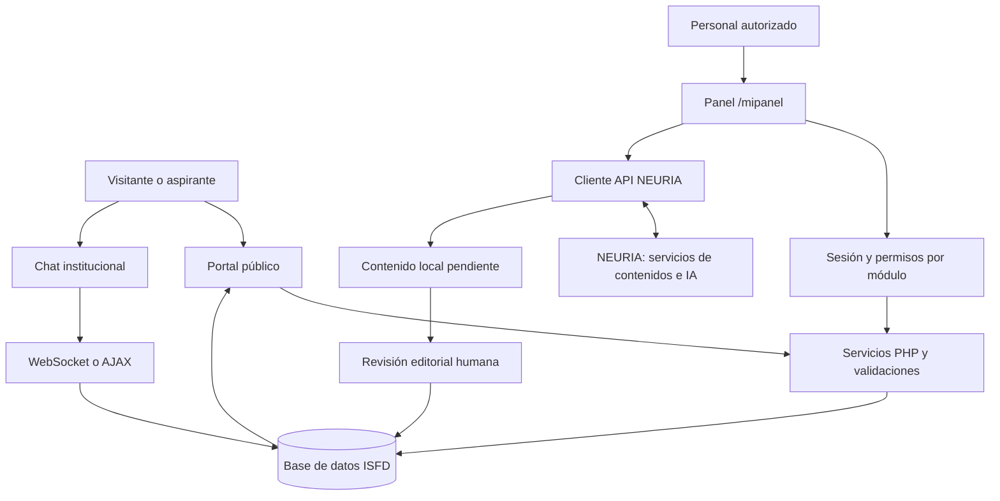
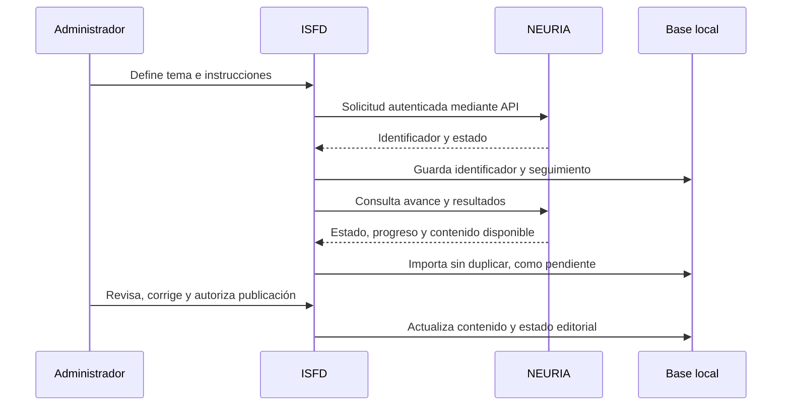

# Informe operacional, lógico y tecnológico del portal ISFD

## Desarrollo institucional con participación humana e inteligencia artificial

**Institución:** Instituto Superior de Formación Docente Continua y Técnica «Félix Atilio Cabrera», Formosa.

**Responsable humano del desarrollo:** Marcos Ortiz.

**Agente de IA de desarrollo:** Codex, de OpenAI.

**Fecha:** 6 de noviembre de 2026.

**Base documental:** código y documentación del proyecto ISFD, con referencia al commit `7a49ef1` y al proceso de trabajo registrado en este proyecto.

Este informe reúne una explicación operacional, lógica y técnica y una propuesta de marco conceptual para la presentación final. Describe funcionalidades implementadas; su disponibilidad en producción depende del despliegue de archivos, migraciones y servicios. La arquitectura interna de NEURIA pertenece a otro proyecto: se describe su relación con ISFD, sin atribuirle modelos de IA o componentes que no se verificaron en este repositorio.

## 1. Síntesis del proyecto

El portal ISFD integra comunicación institucional, información académica y gestión administrativa en una aplicación web. Permite consultar carreras, leer noticias, conocer autoridades, realizar consultas, iniciar una preinscripción y participar del chat institucional. El panel privado organiza la administración de estos recursos y aplica permisos diferenciados a sus usuarios.

Su particularidad es la combinación de una arquitectura web modular, una base de datos institucional, integración con una plataforma externa de contenidos asistidos por IA y un proceso de desarrollo colaborativo entre una persona y un agente de inteligencia artificial.

La participación de IA se presenta en dos ámbitos distintos:

1. **Construcción del sistema:** Codex asiste en el análisis, programación, revisión, comprobaciones y documentación, bajo las necesidades y decisiones del responsable humano.
2. **Operación editorial:** NEURIA centraliza solicitudes de producción de contenidos y entrega sus resultados mediante una API. El personal del instituto conserva la revisión y la decisión de publicación.

El resultado es un sistema sociotécnico: su funcionamiento depende de software, infraestructura, datos y personas con responsabilidades definidas. La automatización facilita tareas, pero las decisiones institucionales permanecen bajo control humano.

## 2. Problema que aborda y objetivos

Una institución educativa necesita mantener información actualizada, comunicar novedades y responder a personas interesadas en su oferta. Si estos procesos quedan dispersos entre documentos, mensajes y páginas estáticas, resulta difícil relacionar consultas con carreras, seguir trámites o identificar quién modificó un contenido.

El proyecto reúne esos procesos en una plataforma con objetivos concretos:

- Centralizar la información pública y permitir su actualización desde un panel.
- Organizar las ofertas académicas mediante un catálogo que facilite filtros y búsquedas.
- Registrar consultas y preinscripciones con seguimiento administrativo.
- Incorporar contenidos de NEURIA con revisión editorial local.
- Administrar usuarios, accesos, acciones y registros de auditoría.
- Conservar la arquitectura existente y ampliar funciones de forma modular.
- Documentar el sistema para facilitar mantenimiento, transferencia y continuidad.

El alcance no equivale a un sistema integral de gestión académica. La preinscripción inicia un trámite: no asigna automáticamente una vacante ni reemplaza su formalización administrativa.

## 3. Marco conceptual para la presentación

### 3.1. Sistema de información institucional

Un sistema de información reúne datos, procedimientos, personas y tecnología para apoyar una actividad. En ISFD, una consulta ingresa como datos de contacto y mensaje; el sistema la relaciona con un tema o carrera; un administrador la interpreta, responde y registra su seguimiento. El valor surge de esa secuencia completa, no solamente del almacenamiento.

La base de datos constituye la memoria operativa del portal. Las interfaces públicas permiten el ingreso y consulta de información; las interfaces privadas permiten gestionarla; las reglas del sistema determinan qué operaciones son válidas.

### 3.2. Arquitectura modular y separación de responsabilidades

La modularidad distribuye funciones entre componentes con propósitos definidos. En este proyecto, Noticias administra información editorial; Ofertas organiza el catálogo; Contactos reúne solicitudes; Control gestiona usuarios; Módulos internos concentra configuraciones exclusivas de Root.

Esta separación favorece el mantenimiento: cambiar un formulario editorial no debería requerir reconstruir la gestión de usuarios. Los módulos comparten recursos de conexión, sesión, permisos y validación, evitando que cada uno defina una política diferente.

### 3.3. Interoperabilidad mediante API

Una API establece cómo dos aplicaciones intercambian información. ISFD y NEURIA pueden utilizar tecnologías internas distintas y comunicarse mediante solicitudes HTTP y respuestas JSON.

La API es el mecanismo de comunicación; la IA es una capacidad del servicio que produce o asiste en la elaboración del contenido. No toda llamada a una API utiliza IA y no toda automatización del portal es inteligente o generativa.

### 3.4. Asincronía y continuidad de uso

La asincronía permite iniciar una operación sin recargar toda la pantalla ni mantener al usuario bloqueado durante un proceso prolongado. Las operaciones AJAX actualizan sectores de la interfaz. Las solicitudes a NEURIA pueden quedar en proceso y consultarse posteriormente. El chat puede recibir eventos mediante WebSocket y continuar con HTTP/AJAX cuando ese transporte no está disponible.

Estos mecanismos resuelven necesidades distintas: actualización parcial de interfaz, seguimiento de trabajos remotos y comunicación persistente.

### 3.5. Datos relacionales e integridad

El modelo relacional representa entidades y vínculos: una categoría agrupa ofertas, una oferta recibe consultas y preinscripciones, una noticia tiene adjuntos y un usuario realiza acciones. Claves, índices y transacciones ayudan a mantener esas relaciones y a evitar resultados incompletos en operaciones agrupadas.

El versionado de contenidos institucionales y el historial de autoridades permiten conservar cambios en el tiempo. Esto distingue el dato vigente de los antecedentes que explican su evolución.

### 3.6. Participación humana en procesos asistidos por IA

La expresión *human-in-the-loop* describe una intervención humana dentro del proceso automatizado. En ISFD se concreta cuando el responsable revisa una implementación propuesta por el agente y cuando un editor revisa una noticia recibida de NEURIA antes de publicarla.

La persona aporta contexto institucional, criterios de pertinencia, prioridades y responsabilidad sobre el resultado. El agente contribuye a transformar instrucciones en código y documentación. Esta colaboración requiere revisión porque una salida generada puede contener errores, interpretaciones inadecuadas o información que deba confirmarse.

Estos conceptos funcionan como marco explicativo del caso. El informe es una sistematización técnica del proyecto, no una investigación experimental que mida el efecto causal de la IA.

## 4. Participantes y responsabilidades

| Participante | Intervención |
|---|---|
| Responsable humano del desarrollo | Define requerimientos, aporta referencias, establece restricciones, revisa resultados, prueba recorridos y decide el despliegue. |
| Codex, agente IA | Analiza archivos, propone soluciones, implementa cambios autorizados, prepara migraciones, ejecuta comprobaciones disponibles y documenta. |
| Root | Administra módulos internos, configuración, credenciales, accesos y consulta de auditoría. |
| Administradores autorizados | Gestionan contenidos y solicitudes según sus permisos por módulo y acción. |
| Editor institucional | Evalúa exactitud, pertinencia y presentación de las noticias antes de activarlas. |
| Visitantes y aspirantes | Consultan información, envían preguntas e inician preinscripciones. |
| Participantes del chat | Mantienen conversaciones sujetas a reglas y moderación. |
| NEURIA | Proporciona servicios de producción y distribución de contenidos mediante su API. |

La participación humana continúa después del desarrollo. Actualizar carreras, responder consultas, revisar noticias y formalizar inscripciones son tareas operativas indispensables para que el sistema cumpla su finalidad.

## 5. Arquitectura general

El portal mantiene una arquitectura PHP modular con renderizado de HTML en el servidor y actualizaciones parciales mediante jQuery/AJAX. No fue convertido a Laravel: Laravel 13 corresponde al proyecto externo NEURIA, según lo informado por su responsable.

El navegador presenta la interfaz y envía peticiones. Apache dirige las rutas a PHP. Los servicios validan las operaciones y consultan la base de datos. El servidor responde con páginas, fragmentos HTML o JSON, según el recorrido.

La lectura pública de noticias utiliza la base local. Una indisponibilidad de NEURIA puede impedir nuevas sincronizaciones, pero no exige retirar las noticias ya guardadas y autorizadas en ISFD.

## 6. Tecnologías y recursos digitales

Las versiones siguientes son las documentadas en el repositorio; no constituyen una verificación de las versiones instaladas actualmente en el hosting.

| Tecnología o recurso | Aplicación en el proyecto |
|---|---|
| PHP 8.2+ | Lógica del servidor, módulos, formularios, validaciones e integración. |
| Apache y mod_rewrite | Publicación web, rutas amigables y reglas de acceso mediante `.htaccess`. |
| MySQL/MariaDB e InnoDB | Persistencia relacional, índices, relaciones, transacciones y vistas del catálogo. |
| mysqli/mysqlnd | Acceso a datos mediante consultas preparadas y la capa compartida de conexión. |
| Plantillas HTML y PHPLIB | Separación de presentación y datos en las vistas por módulo. |
| HTML y CSS | Estructura, identidad visual, adaptación de formularios y presentación pública. |
| JavaScript y jQuery 3.7.1 | Interacciones, AJAX, filtros, carga parcial y previsualizaciones. |
| Bootstrap 5.3.8 e Icons 1.13.1 | Grilla responsive, navegación, ventanas, formularios e iconografía. |
| HTTP/HTTPS, JSON y cURL | Comunicación del servidor ISFD con NEURIA. |
| OpenSSL y AES-256-GCM | Cifrado de tokens de integración almacenados en la base de datos. |
| GD | Generación de imágenes de captcha y recursos gráficos. |
| fileinfo y ZipArchive | Comprobación de tipos de archivos y reconocimiento de documentos admitidos. |
| mbstring, iconv y DOM | Tratamiento de texto, normalización y procesamiento de contenido editorial. |
| Ratchet 0.4.4 y ReactPHP | Servidor opcional de WebSocket para el chat. |
| Composer | Instalación de dependencias del servidor WebSocket. |
| Node.js | Herramientas de comprobación de JavaScript durante el desarrollo; no sirve el portal PHP. |
| XAMPP sobre Windows | Entorno local utilizado para desarrollar y probar. |
| Hosting con cPanel | Administración del entorno de producción, archivos y base de datos. |
| phpMyAdmin y migraciones SQL | Importación y actualización de estructuras y datos. |
| Git y GitHub | Historial de cambios y sincronización del repositorio del proyecto. |
| Codex | Agente de IA utilizado durante el desarrollo y la documentación. |
| NEURIA | Plataforma externa que centraliza la integración de contenidos asistidos por IA. |

Se utilizan también enlaces al Campus Virtual del INFD, redes sociales, WhatsApp y reproductores externos como YouTube, Vimeo y HeyGen en los recorridos admitidos. Un video de HeyGen incrustado se reproduce desde esa plataforma: el portal no genera ese video por sí mismo.

Los recursos cargados desde CDN y los servicios multimedia externos dependen de conectividad y disponibilidad de sus proveedores. La carga de adjuntos locales utiliza el almacenamiento del servidor.

## 7. Organización funcional y modelo de información

| Área | Función y datos principales |
|---|---|
| Home | Presentación institucional, novedades, catálogo, autoridades, videos y contacto. |
| Login y Control | Autenticación, usuarios, roles y permisos de acceso y operación. |
| Ofertas | Carreras, categorías, modalidades, información de inscripción, imágenes, video y plan de estudios. |
| Noticias | Producción local, contenidos de NEURIA, estados editoriales y adjuntos. |
| Contactos | Consultas generales y por carrera, preinscripciones y acceso a moderación del chat. |
| Módulos internos | Configuración de dominio, contenido institucional, autoridades, integraciones y auditoría, exclusivos de Root. |
| Chat | Cuentas de participantes, salas, mensajes, presencia y moderación. |

El catálogo utiliza entidades relacionadas como `catalogo_categorias`, `catalogo_niveles`, `ofertas` y `oferta_convocatorias`. Las noticias y sus archivos se conservan en `noticias` y `noticia_archivos`. Las solicitudes remotas se registran en `neuria_requests` y se vinculan con sus contenidos.

Las consultas se guardan en `portal_consultas`; las preinscripciones, en `portal_preinscripciones`, con un historial asociado. Los contenidos institucionales cuentan con secciones, versiones y valores. Las autoridades tienen registros e historial propios. La auditoría utiliza `system_05_logistica`.

Esta organización permite relacionar procesos sin reunir toda la información en una sola tabla. También conserva datos históricos relevantes: por ejemplo, el título de la oferta al recibir una preinscripción.

## 8. Flujos operacionales principales

### 8.1. Publicación de una oferta académica

El administrador registra o modifica una oferta, la clasifica y completa su descripción, destinatarios, requisitos y plan de estudios. Puede incorporar imagen y video. Su publicación y la apertura de inscripción son decisiones diferenciadas.

La portada muestra las ofertas habilitadas. Los filtros ofrecen categorías activas que cuentan con contenido publicable, evitando opciones sin resultados. El visitante accede a una vista completa y puede consultar por esa carrera.

Cuando corresponde, se destaca la preinscripción. El servidor comprueba nuevamente la disponibilidad de la oferta al recibir el formulario; mostrar un botón no sustituye esa validación.

### 8.2. Consulta general o por carrera

El visitante completa datos de contacto, celular, mensaje, consentimiento y captcha. En una consulta académica, el servidor identifica la oferta y conserva su relación con la solicitud.

Tras validar los datos, registra la consulta y la entrada de la bandeja transaccional en una misma transacción. El personal consulta la lista, atiende el caso y actualiza su estado. Cuando hay un celular válido, el icono de WhatsApp abre el contacto para que la persona administradora redacte y envíe el mensaje.

La bandeja de salida desacopla el registro del eventual envío. Su existencia no demuestra que se haya entregado un correo: no se identificó un trabajador de envío activo en los recorridos documentados. Tampoco el enlace de WhatsApp envía mensajes automáticamente.

### 8.3. Preinscripción institucional

Si se configuró una URL externa, los enlaces utilizan ese destino. Cuando no existe, se abre el formulario institucional. Desde la portada se selecciona una carrera; desde su detalle se presenta la oferta correspondiente.

El formulario solicita información básica, incluye celular obligatorio y utiliza captcha y otras validaciones. Registra una solicitud por DNI, carrera y año de recepción, evitando duplicados ante reenvíos. Ese año no representa necesariamente el ciclo académico de cursada.

En Contactos, el personal puede consultar el resumen por carrera, filtrar solicitudes y registrar seguimiento y notas. La formalización posterior corresponde a la institución; no hay confirmación automática de vacante ni envío automático de correo de preinscripción en esta etapa.

### 8.4. Noticias y adjuntos

El editor guarda primero el contenido textual. Con una noticia ya identificada, administra imágenes con vista previa, enlace de video y documentos descargables. Separar estas operaciones permite incorporar archivos sin depender de una única carga extensa del formulario completo.

La publicación se controla mediante estados. La portada consulta noticias activas locales. Recibir un contenido de NEURIA no lo vuelve público automáticamente.

### 8.5. Contenido institucional

Root mantiene datos de identidad, contacto, enlaces, textos institucionales, autoridades y videos. Los textos versionados permiten conservar antecedentes. Las autoridades pueden cambiar sin perder su historial y pueden contar con foto y saludo audiovisual.

El portal presenta esos datos desde la base, reduciendo la necesidad de editar archivos PHP para actualizar información institucional cotidiana.

### 8.6. Chat institucional

El chat dispone de cuentas propias, salas, mensajes y mecanismos de moderación. Se abre desde los accesos del portal y su gestión se encuentra vinculada al módulo Contactos.

El transporte WebSocket permite comunicación persistente cuando el servidor correspondiente está disponible. El mecanismo HTTP/AJAX proporciona continuidad cuando no se logra establecer esa conexión. Los identificadores de envío ayudan a evitar duplicados durante reintentos.

El chat actual conecta personas. Su moderación automática utiliza reglas locales; no constituye un asistente generativo ni envía las conversaciones a NEURIA.

## 9. NEURIA como eje de integración de IA y contenidos

NEURIA concentra la capacidad de recibir solicitudes de producción y entregar contenidos. ISFD funciona como cliente institucional: autentica su conexión, envía instrucciones, consulta avances, importa resultados y aplica su propio proceso editorial.

La centralización permite conservar un punto de integración común sin incorporar un proveedor de modelos generativos directamente en cada módulo del portal. Esto introduce una dependencia externa para producir o recibir nuevos contenidos, pero mantiene la persistencia y publicación local bajo control de ISFD.

La integración emplea autenticación Bearer desde el servidor. Root configura la URL y las credenciales; el token se almacena cifrado y depende de una clave privada de configuración. El diagnóstico de conexión permite comprobar identidad del medio, organización y permisos otorgados.

El seguimiento conserva identificadores remotos y progreso. Una solicitud en `ERROR` puede recuperarse si se reintenta en NEURIA: ISFD vuelve a consultarla, actualiza su estado y limpia el error anterior al recuperarse. La importación utiliza identificadores únicos y transacciones para evitar noticias duplicadas.

Los datos originales de NEURIA se distinguen de los campos editoriales locales. Una sincronización no debe sobrescribir silenciosamente el trabajo del editor. Los eventos de suspensión o retiro remoto también tienen tratamiento local.

Existen comandos y recorridos de sincronización manual y scripts preparados para programación periódica. La presencia de esos scripts no demuestra que un cron esté instalado en producción.

## 10. Desarrollo colaborativo humano–agente IA

El proceso se construyó mediante iteraciones. El responsable planteó necesidades en lenguaje natural, aportó capturas y ejemplos, definió restricciones y probó resultados. El agente analizó el proyecto y tradujo esos pedidos en cambios técnicos concretos.

El ciclo de trabajo puede expresarse así:

**Necesidad institucional → instrucción humana → análisis del agente → implementación → comprobaciones técnicas → revisión humana → ajustes → versionado → despliegue decidido por el responsable.**

Ejemplos de esta colaboración son la conservación de PHP y jQuery/AJAX, la incorporación de revisión editorial antes de publicar contenidos de NEURIA, los formularios de preinscripción, los permisos ABME y la auditoría administrativa. En cada caso, las decisiones respondieron a una necesidad expresada y se ajustaron mediante revisión del funcionamiento.

La participación del agente excede la sugerencia de fragmentos de código: incluye lectura del proyecto, modificación de archivos, preparación de SQL, ejecución de verificaciones y redacción de manuales. Sin embargo, la ejecución de herramientas no garantiza por sí misma que una solución sea correcta. Las pruebas, la revisión del código y la evaluación de los usuarios siguen siendo necesarias.

El responsable humano conserva la dirección del proyecto, el conocimiento institucional y la aprobación práctica del resultado. El historial Git permite rastrear cambios, pero no mide por sí solo cuánto trabajo intelectual aportó cada participante.

No se dispone de una medición controlada de horas ahorradas, reducción de costos o porcentaje de código atribuible a IA. Por ello, el aporte se presenta mediante funciones realizadas y evidencia del proceso, sin inventar indicadores de productividad.

## 11. Seguridad, permisos y trazabilidad

El panel combina autenticación con autorización. Ingresar al sistema no habilita todas las acciones: los usuarios no Root necesitan acceso al módulo y permisos explícitos para Agregar, Borrar, Modificar y cambiar Estado.

Los controles se aplican tanto en la interfaz como en los endpoints. Ocultar un botón mejora la experiencia, pero la restricción efectiva debe verificarse en el servidor. Módulos internos permanece reservado a Root.

Entre las medidas implementadas se encuentran consultas preparadas, protección CSRF, escape de contenido, validación de archivos, contraseñas mediante funciones de hash, controles de sesión, captcha y límites de recepción en determinados formularios. Las credenciales de NEURIA no deben incorporarse a Git ni exponerse en el navegador.

La auditoría registra acciones administrativas con identidad, fecha, módulo y detalles pertinentes. Root dispone de una consulta filtrable. Este registro ayuda a reconstruir operaciones, pero no es un sistema criptográficamente inmutable: un acceso directo con privilegios a la base podría modificarlo.

Estos controles reducen riesgos; no constituyen una certificación de seguridad. La protección también depende de la configuración del hosting, actualización de dependencias, custodia de credenciales y copias de respaldo.

## 12. Operación, despliegue y mantenimiento

El desarrollo local utiliza XAMPP y la publicación utiliza un entorno de hosting administrado con cPanel. El despliegue combina actualización de archivos, migraciones SQL y configuración específica del entorno.

La configuración local no debe trasladarse indiscriminadamente: conexiones, rutas, tokens y claves privadas pueden diferir. Antes de modificar la base de producción corresponde contar con respaldo y conocer las migraciones ya aplicadas. El código versionado y los datos operativos requieren estrategias de respaldo complementarias.

WebSocket agrega un requisito particular: un proceso persistente, supervisión y conectividad adecuada, normalmente con WSS bajo HTTPS. Subir las carpetas del chat no instala ese servicio. El fallback AJAX permite mantener un transporte compatible mientras se configura esa infraestructura.

Los controles de mantenimiento incluyen revisar registros de errores, probar formularios públicos, verificar sincronización, comprobar permisos y conservar documentación. Los cambios de estructura deben acompañarse de migraciones; los cambios de comportamiento deben reflejarse en los manuales.

## 13. Resultados observables, límites y evaluación

El proyecto cuenta con administración modular, catálogo filtrable, publicación local de noticias, integración con NEURIA, consultas y preinscripciones persistentes, chat y control de acciones administrativas. Estos elementos permiten presentar resultados funcionales concretos.

Conviene demostrar en la presentación un recorrido completo: crear o importar una noticia pendiente, revisarla, activarla y verla en la portada; o recibir una consulta asociada a una carrera y seguirla en Contactos. Esa demostración conecta interfaz, reglas, datos y participación humana.

Los límites que deben quedar claros son:

- El portal no contiene un modelo generativo propio ni una conexión local directa a un SDK de OpenAI.
- No se verifican en este informe los modelos, proveedores ni procesos internos de NEURIA.
- El chat no es un chatbot generativo.
- La preinscripción no formaliza automáticamente el ingreso.
- Guardar una notificación en una bandeja no prueba su entrega.
- Un script de cron o WebSocket disponible en el repositorio no demuestra su instalación en el hosting.
- No se midieron beneficios económicos ni una mejora porcentual de productividad atribuible a la IA.

Para una evaluación posterior pueden registrarse tiempo de respuesta a consultas, proporción de solicitudes atendidas, finalización de preinscripciones, incidencias de sincronización, errores detectados durante revisión editorial y resultados de pruebas de permisos. Son indicadores propuestos, no mediciones realizadas.

## 14. Guion sugerido para la presentación final

| Momento | Idea central | Evidencia que puede mostrarse |
|---|---|---|
| 1. Necesidad | La institución necesita comunicar y gestionar información relacionada. | Portada y necesidades iniciales. |
| 2. Solución | Un portal modular conecta comunicación y gestión. | Módulos y diagrama general. |
| 3. Tecnología | PHP, base relacional y AJAX sostienen los recorridos. | Un formulario y sus datos persistidos, sin exponer información personal. |
| 4. IA en el desarrollo | Humano y agente iteraron sobre problemas concretos. | Un cambio documentado y su revisión en Git. |
| 5. NEURIA | La producción asistida se integra mediante API. | Seguimiento de solicitud y noticia pendiente. |
| 6. Control humano | La institución revisa, corrige y decide. | Publicación editorial y permisos. |
| 7. Operación | Consultas y preinscripciones requieren seguimiento. | Panel con datos de demostración. |
| 8. Continuidad | El mantenimiento y la infraestructura completan la solución. | Manuales, migraciones y límites actuales. |

**Texto de cierre propuesto para exponer:**

> El proyecto ISFD muestra una forma de desarrollo colaborativo en la que la inteligencia artificial participa en tareas de análisis, implementación y documentación, mientras la persona responsable aporta contexto, dirección y revisión. Durante la operación, NEURIA centraliza la producción asistida de contenidos y el instituto conserva la decisión editorial. La tecnología conecta esos procesos mediante una aplicación modular y una base de datos institucional. El aporte de la IA se entiende así dentro de un proceso humano y técnico verificable, con responsabilidades, controles y límites definidos.

## 15. Fuentes internas y trazabilidad del informe

Este documento se fundamenta en los artefactos del proyecto y en las decisiones de trabajo registradas. Las guías siguientes amplían los detalles técnicos y operativos; no sustituyen una bibliografía académica externa si la institución exige un formato formal de investigación.

- [Manual técnico](MANUAL_TECNICO.md): arquitectura, tecnologías, servicios, datos y límites.
- [Manual del administrador](MANUAL_ADMINISTRADOR.md): recorridos de uso del panel.
- [Integración NEURIA API v1](NEURIA_V1.md): autenticación, sincronización y recuperación de solicitudes.
- [Noticias](NOTICIAS.md) y [catálogo académico](CATALOGO.md): gestión editorial y académica.
- [Permisos](PERMISOS.md) y [auditoría](AUDITORIA.md): acceso, acciones y trazabilidad.
- [Chat institucional](CHAT_INSTITUCIONAL.md) y [WebSocket](CHAT_WEBSOCKET.md): comunicación y transporte.
- [Preinscripciones](PREINSCRIPCIONES.md): recepción y seguimiento; para permisos actuales prevalece la guía de permisos.
- [Contenido institucional](CONTENIDO_INSTITUCIONAL.md), [autoridades](AUTORIDADES.md) y [videos](VIDEOS_INSTITUCIONALES.md).
- [Importación y despliegue](../database/IMPORTACION_PRODUCCION.md): actualización de entornos.

Como evidencia de implementación, pueden consultarse `lib/app.php`, `lib/permisos.php`, `scripts/app_ajax.js`, los módulos de `sistema/modulos/`, `chat/`, `preinscripcion/`, `database/` y `tests/`. El directorio de pruebas y el historial Git documentan recursos de verificación y evolución; este informe no implica que se haya vuelto a ejecutar la totalidad de las pruebas ni auditado el servidor de producción.
