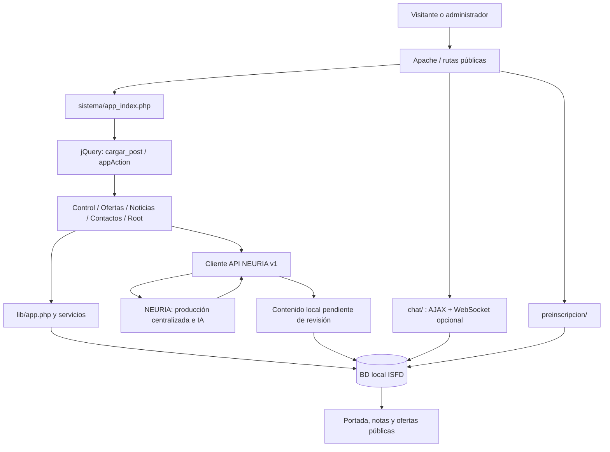
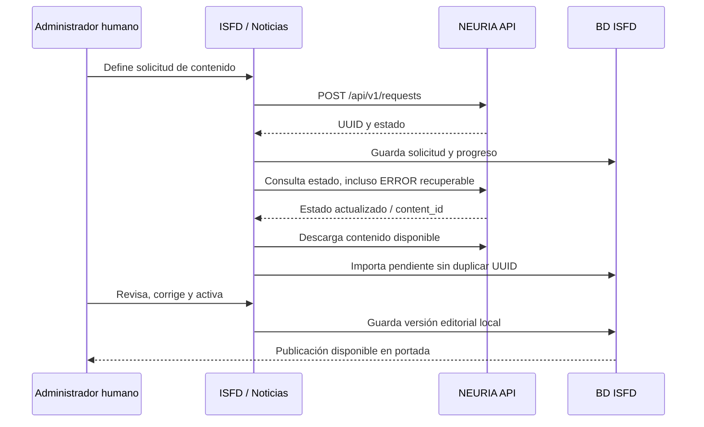

# Manual técnico — Portal institucional ISFD

Revisión: 5 de noviembre de 2026. Incluye autorización por usuario/módulo y migración 021.
Institución: Instituto Superior Félix Atilio Cabrera, Formosa.

Este manual describe el código implementado y sus límites. No certifica el estado de un servidor remoto ni reemplaza el registro de despliegues. Las rutas de archivos se expresan desde la raíz del repositorio. No contiene contraseñas ni tokens reales.

## 1. Finalidad y organización

El portal integra información institucional, catálogo académico, noticias, consultas, preinscripciones y una comunidad de chat. Conserva la arquitectura PHP modular del proyecto original: no fue convertido a Laravel ni a una SPA de React/Vue.

NEURIA es el eje de la integración de contenidos e IA. ISFD actúa como proyecto cliente: solicita trabajos, consulta avances, recibe contenidos y aplica revisión editorial local antes de publicarlos. La centralización en NEURIA permite mantener esa capacidad fuera de cada módulo del sitio, con una credencial del medio y contratos API comunes.

El proyecto NEURIA está desarrollado en Laravel 13, según lo informado por su responsable. Su implementación interna y los modelos de IA que utiliza pertenecen a otro repositorio: no se infieren ni se documentan como dependencias locales del ISFD.

## 2. Desarrollo híbrido: factor humano y agente IA

El sitio se desarrolló mediante colaboración activa entre el responsable humano del proyecto y Codex como agente IA de desarrollo.

| Participante | Responsabilidad en el proceso |
|---|---|
| Responsable humano | Define objetivos, necesidades institucionales, arquitectura a conservar, diseño de referencia, contenido, prioridades y criterios de aceptación. Revisa los resultados, prueba recorridos, administra credenciales y decide el despliegue. |
| Agente IA de desarrollo | Inspecciona el código, propone y realiza cambios autorizados, prepara migraciones, implementa interfaces y servicios, ejecuta verificaciones y redacta documentación. Realiza commits y push cuando se solicitan. |
| Administrador editorial | Revisa y corrige los contenidos propios o recibidos de NEURIA y decide su publicación dentro de los permisos disponibles. |
| NEURIA | Centraliza solicitudes de producción asistida por IA y entrega contenidos/estados mediante su API. No sustituye la aprobación editorial del instituto. |

Flujo de trabajo utilizado: necesidad humana → propuesta/implementación del agente → pruebas técnicas → revisión humana → corrección → versionado → despliegue autorizado. El historial Git conserva los cambios de código; esta documentación registra decisiones y procedimientos, sin convertir la conversación completa en una especificación permanente.

Hay dos usos de IA distintos: la asistencia de Codex durante el desarrollo y la producción de contenidos a través de NEURIA durante la operación. El chat institucional es una conversación entre participantes: su moderación automática actual usa reglas locales, no un modelo generativo. No se envían sus conversaciones a NEURIA.

## 3. Tecnologías y recursos

Versiones observadas en el repositorio, no promesas de compatibilidad con versiones futuras:

| Recurso | Implementación y función |
|---|---|
| PHP | Base del proyecto PHP 8.2+; entorno de desarrollo XAMPP/Windows. El paquete WebSocket declara PHP `^8.1`, pero el conjunto del portal se documenta con 8.2+. |
| Apache | Enrutamiento con `mod_rewrite`, archivos `.htaccess`, directorios públicos y control de índices. |
| MySQL/MariaDB | InnoDB, consultas preparadas, transacciones, claves/índices, vistas y rutinas opcionales del catálogo. Codificación `utf8mb4`; las migraciones recientes usan `utf8mb4_unicode_ci`. |
| mysqli/mysqlnd | `AppDatabase` en `lib/app.php`; usa `mysqli_stmt::get_result()`. |
| Plantillas PHP/PHPLIB | `lib/template.inc`, plantillas HTML por módulo y variables escapadas. |
| JavaScript y jQuery | jQuery 3.7.1; cargas parciales, formularios AJAX, vistas previas, filtros y transporte del chat. |
| Bootstrap | 5.3.8; grilla responsive, formularios, paneles, modal y utilidades. Bootstrap Icons 1.13.1. |
| CSS propio | `css/portal.css`, `css/app_admin.css`, `css/estilos_codex.css`; estilos específicos en chat y preinscripción. Paleta institucional granate y acentos del escudo. |
| cURL / JSON | Cliente HTTP de NEURIA, autenticación Bearer, validación de respuestas y reintentos acotados. |
| OpenSSL | AES-256-GCM para cifrar credenciales de integración. |
| GD | Imágenes PNG del captcha y recursos gráficos del chat. |
| fileinfo / ZipArchive | MIME real de uploads; reconocimiento de estructuras DOCX/XLSX cuando el servidor las detecta como ZIP. |
| mbstring / iconv / DOM | Texto UTF-8, normalización de slugs y sanitización editorial. |
| Ratchet / ReactPHP | WebSocket persistente: Ratchet 0.4.4 y dependencias fijadas en `chat/server/composer.lock`. |
| Composer | Dependencias del servidor del chat; no es un gestor global de toda la aplicación. |
| Node.js | Herramienta de desarrollo para comprobar JavaScript y ejecutar pruebas del transporte. No es necesario para servir el portal PHP. |
| Git / GitHub | Versionado y repositorio remoto `MarcosOrtizFsa/isfd`; rama utilizada `master`. |
| Servicios externos | API NEURIA, reproductores YouTube y plataformas admitidas por el módulo institucional, Campus Virtual, formularios externos opcionales, mapas y redes. |

Bootstrap, iconos y jQuery se cargan desde CDN según las plantillas. Los recursos gráficos institucionales se encuentran en `image/`; los archivos cargados se guardan en `uploads/`. Los CDN y reproductores externos requieren conectividad del navegador.

No se implementaron una dependencia local del SDK de OpenAI, un proveedor LLM directo, Redis, una cola Laravel ni un servicio de envío automático de preinscripciones.

## 4. Arquitectura y flujo

`index.php` inicia la portada mediante el shell de `sistema/app_index.php`. El layout `sistema/templates/app_index.html` define el `<base>`, metadatos sociales, token CSRF, navegación y `#content_seccion`. `scripts/app_ajax.js` carga fragmentos mediante POST; no se debe reemplazar este recorrido con recargas completas arbitrarias.

`lib/app.php` concentra conexión, sesiones, autorización compartida con `lib/permisos.php`, escape HTML, CSRF, JSON y auditoría. Los servicios de negocio realizan consultas preparadas. `AppDatabase::transaction()` hace commit o rollback; no proporciona transacciones anidadas.

| Ubicación | Responsabilidad |
|---|---|
| `sistema/modulos/home/` | Portada pública, lectura de noticias y ofertas, templates y repositorios públicos. |
| `sistema/modulos/login/` | Acceso a `/mipanel`. |
| `sistema/modulos/control/` | Usuarios del equipo administrador. |
| `sistema/modulos/ofertas/` | ABM académico, categorías, convocatoria, imagen, video y plan de estudios. |
| `sistema/modulos/noticias/` | Edición local, adjuntos, solicitudes IA, sincronización y diagnóstico de NEURIA. |
| `sistema/modulos/contactos/` | Consultas, preinscripciones y acceso a moderación del chat. |
| `sistema/modulos/root/` | Módulos internos, configuración de dominio, contenido institucional y credenciales. |
| `chat/` | Comunidad con cuentas propias, presencia, salas, mensajes y moderación. |
| `preinscripcion/` | Formulario independiente, validación y servicio de seguimiento. |
| `sistema/api/` | Endpoints públicos de catálogo, consultas y captcha. |
| `database/` | Migraciones, semillas y utilidades de importación. |
| `tests/` | Verificaciones PHP/JS y pruebas con servidores mock o datos temporales. |

Hay archivos heredados fuera de estos recorridos. Su presencia no implica que estén activos; antes de retirarlos, rastrear referencias. No extender el cliente antiguo de NEURIA para nuevas funciones.

## 5. Rutas y contratos internos

| Ruta | Uso |
|---|---|
| `/` | Portada pública. |
| `/mipanel` | Login y shell administrativo; conservar esta URL al ingresar. |
| `/nota/{id}/{slug}` | Noticia activa local; metadatos sociales generados por servidor. |
| `/oferta/{slug}` | Detalle académico, consulta, plan y preinscripción condicional. |
| `/api/ofertas-academicas` | Consulta pública paginada y filtrada. |
| `/api/ofertas-academicas/{slug}` | Detalle público de oferta. |
| `/api/catalogo/arbol` | Jerarquía académica y conteos. |
| `/api/ofertas-academicas/{id}/consultas` | POST de consulta asociada a oferta. |
| `/api/contacto` | POST de consulta general. |
| `/api/captcha?context=…` | PNG de desafío por sesión: contacto, oferta o preinscripción. |
| `/chat/`, `/chat/api.php` | Interfaz y operaciones del chat. |
| `/chat/admin.php` | Moderación según acceso y permisos de Contactos; Root sin restricciones. |
| `/preinscripcion/`, `/preinscripcion/api.php` | Formulario y POST de recepción. |

Los endpoints de `sistema/modulos/*/php/app_*.php` son interfaces internas, no una API pública estable. Los formularios mutables verifican sesión/rol cuando corresponde y token CSRF. Los endpoints de adjuntos reciben multipart; los de texto reciben campos de formulario. Para errores mostrar `message` sin insertar HTML sin escapar.

## 6. Identidad y permisos

Los permisos se asignan por usuario y módulo en Control, exclusivamente por Root. Director y todos los roles no root requieren Acceso y acciones explícitas A/B/M/E; no se heredan por modo. Módulos internos sigue reservado a modo 0. Contactos incluye preinscripciones y moderación de chat bajo la misma asignación.

La migración 021 agrega `system_02_acceso` a `system_02_permisos`. El menú, los formularios y los endpoints consumen `lib/permisos.php`; las escrituras verifican acción y CSRF. Un cambio de estado por save también exige E. La identidad/estado del usuario se relee por petición para hacer efectivas las revocaciones.

El chat público conserva cuentas independientes. Los formularios públicos de consultas/preinscripción siguen disponibles sin cuenta administrativa y conservan captcha/CSRF.

Ver [PERMISOS.md](PERMISOS.md) para matriz, restricciones de jerarquía, despliegue y pruebas. Los controladores heredados de Control, Ofertas y Root responden 410: usar las entradas actuales `app_*`.

Las contraseñas usan `password_hash()` / `password_verify()`. El login administrativo conserva compatibilidad de migración de hashes históricos al ingresar correctamente. La sesión PHP se denomina `ISFDSESSID`; las claves de autenticación del chat y del administrador están separadas. Las cookies son HttpOnly, SameSite=Lax y Secure bajo HTTPS detectado.

## 7. Modelo de datos por dominio

| Dominio | Tablas/objetos principales |
|---|---|
| Sistema existente | `system_01_modulos`, `system_02_permisos`, `system_03_usuarios`, `system_04_perfil`, `system_05_logistica`, catálogos `system_06*` / `system_07*`, `system_08_configuracion`. |
| Académico | `catalogo_niveles`, `catalogo_categorias`, `ofertas`, `modalidades`, `unidades_academicas`, `oferta_convocatorias`, `oferta_plan_estudios`, `oferta_documentos`, `turnos`, `oferta_turno`, `areas_conocimiento`, `oferta_area`. |
| Vistas públicas | `v_catalogo_ofertas`, `v_oferta_convocatorias_priorizadas`. |
| Editorial | `noticias`, `noticia_archivos`. El video de la nota se conserva en `noticias.youtube_codigo`. |
| NEURIA | `neuria_sincronizaciones`, `neuria_requests`, `integracion_credenciales` y campos `neuria_*` en noticias. |
| Institucional | `institucional_secciones`, `institucional_versiones`, `institucional_valores`, `institucional_autoridades`, `institucional_autoridades_historial`. |
| Contacto | `portal_consultas`, `portal_bandeja_salida`. |
| Preinscripción | `portal_preinscripciones`, `portal_preinscripcion_historial`. |
| Chat | `chat_usuarios`, `chat_avatares`, `chat_salas`, `chat_presencias`, `chat_mensajes`, `chat_notificaciones`, `chat_reportes`, `chat_auditoria`, `chat_limites`. |
| WebSocket | `chat_ws_tokens`, `chat_ws_revision`. |

El detalle SQL es la fuente de verdad de columnas, índices y relaciones. [Catálogo ER](catalogo-er.md) cubre el dominio académico, no toda la BD. Las tablas existentes del sistema no se reconstruyen solamente ejecutando las migraciones del portal.

### Reglas de catálogo

Árbol de hasta tres niveles, rutas materializadas `/id/id/`, nivel coherente entre padre e hija y categorías que admiten ofertas o agrupan subcategorías. El ABM conserva ubicación y slug de categorías existentes. Las categorías relacionadas se desactivan; no se eliminan mientras tengan ofertas o hijas.

El filtro Tipo público exige categoría activa, nivel activo, ancestros activos y al menos una oferta publicada/no eliminada. Una inscripción cerrada no equivale a oferta despublicada: puede seguir siendo información pública. Desactivar una rama también afecta listado, detalle y conteos del catálogo.

### Contenido institucional

Las secciones se versionan con año, motivo y usuario; `version_actual` referencia la vigente. Autoridades tienen registros propios e historial. Los videos institucionales se administran como lista versionada. La configuración global mantiene dominio, redes, contactos y campos heredados; los contadores 1–4 no tienen un uso público nuevo en este desarrollo.

## 8. NEURIA: integración central de contenidos e IA

Cliente: `neuria_v1_cliente.php`; sincronización: `neuria_sync.php`; solicitudes: `neuria_requests.php`, dentro de Noticias. Se consume HTTPS en producción; HTTP se admite para localhost. La credencial viaja como Bearer en encabezados desde PHP, nunca desde JavaScript.

| Método y endpoint remoto | Función |
|---|---|
| `GET /api/v1/me` | Identidad de medio, organización y permisos. |
| `GET /api/v1/contents` | Listado paginado/cursor de contenidos disponibles. |
| `GET /api/v1/contents/{uuid}` | Descarga individual. |
| `GET /api/v1/changes` | Eventos incrementales del contenido. |
| `POST /api/v1/requests` | Solicitud de producción mediante Agente IA. |
| `GET /api/v1/requests/{uuid}` | Estado, progreso y destinos de una solicitud. |

Permisos comprobados durante la integración: `content:read` y `requests:write`. La capacidad concreta depende del token emitido por NEURIA. Base de producción indicada: `https://neuriar.com.ar`; no agregar dos veces `/api/v1`.

Las solicitudes incluyen tema, descripción, instrucciones, categoría, prioridad, opción de búsqueda web y URLs iniciales. El cliente no conoce ni administra los prompts internos, proveedores LLM, costos ni modelos empleados por NEURIA.

Una solicitud local en ERROR sigue consultándose: NEURIA puede reintentarla y llevarla nuevamente a PENDIENTE, INVESTIGANDO, GENERANDO o COMPLETADA. La recuperación actualiza progreso, limpia el error anterior y revierte la fecha de cierre cuando corresponde. La descarga fallida revierte la transacción para permitir otro intento.

Los originales remotos y la edición local se conservan separados. `body` de NEURIA se maneja como texto plano, sin envolver cada párrafo en `
` al guardar, manteniendo separaciones entre párrafos. La presentación pública genera el HTML necesario. Las nuevas importaciones quedan pendientes; suspensión/retiro remoto bloquea publicación y reactivación vuelve a revisión.

El indicador de Noticias realiza una comprobación AJAX breve contra `/me`, con timeout máximo de cinco segundos y sin reintentos. Verifica conexión/autenticación; no demuestra que la sincronización esté ejecutándose ni que una generación termine correctamente. No modifica los cursores.

La configuración activa y descifrable de BD tiene prioridad sobre las variables NEURIA del entorno. El cliente existente puede recurrir al entorno si no obtiene configuración válida de BD; el indicador trata expresamente la fila desactivada como desactivación. Por esa diferencia, para detener operativamente toda sincronización hay que revisar también variables y cron, no depender solo del indicador.

## 9. Noticias y adjuntos

Primero se guarda texto, datos editoriales y estado. La respuesta devuelve el ID local y habilita `#news-attachments-panel` sin cerrar el editor. `app_adjuntos.php` renderiza paneles independientes; `app_adjuntos_action.php` procesa uploads, bajas y video. `js/editor.js` y `js/adjuntos.js` mantienen el comportamiento AJAX.

- Guardar texto no reemplaza `youtube_codigo` ni archivos.
- Imágenes: JPEG, PNG, WebP, GIF; máximo 8 MB cada una, vista previa local y guardada.
- Documentos: PDF, DOC, DOCX, XLS, XLSX; máximo 15 MB cada uno.
- Máximo diez archivos por carga; también rigen `upload_max_filesize`, `post_max_size` y `max_file_uploads` de PHP.
- MIME real por `fileinfo`; imágenes verificadas; ZIP Office reconocido por estructura cuando corresponde.
- Directorio `uploads/noticias/YYYY/MM`, nombre aleatorio, nombre original como metadato. La primera imagen ordenada es la portada.
- Un video YouTube por noticia en el esquema actual, con guardar/quitar/vista previa independiente. No admite HTML de iframe arbitrario.
- Bajas de archivos lógicas mediante `deleted_at`; no hay purga automática de binarios.

La modificación de adjuntos recarga solo su panel y conserva el texto en edición. Los archivos importados/guardados antes del cambio siguen utilizando la misma tabla. No requirió migración SQL.

## 10. Consultas y preinscripciones

Las consultas generales y por oferta comparten `portal_consultas`; el servidor determina el tema de la oferta, verifica captcha/CSRF/consentimiento y valida celular `0000 000000`. La bandeja de salida se registra en la misma transacción. Guardar una fila en `portal_bandeja_salida` no prueba entrega de correo: no se identificó un trabajador de envío dentro de los recorridos actuales.

Preinscripción: si la URL institucional externa está vacía, abre `/preinscripcion/`; desde la oferta agrega `?oferta=ID`. Solo lista carreras publicadas, no eliminadas, de ramas activas y con estado `inscripcion_abierta`. El servidor vuelve a validar antes del alta.

Solicita nombre, apellido, DNI de 7–8 dígitos, email, celular y consentimiento, con captcha y campo trampa. Conserva una solicitud por carrera/DNI/año de recepción; un reenvío no sustituye datos anteriores. El año no es una convocatoria académica. Se aplica un límite de cinco altas por IP/hora. Contactos permite seguimiento, notas e historial; no confirma vacantes automáticamente ni envía correo de preinscripción.

## 11. Chat y WebSocket

Chat con cuentas propias, salas, avatares exclusivos, mensajes, menciones, respuestas, presencia, notificaciones, reportes y auditoría. Hay cinco salas y 512 avatares iniciales. Email sin verificación y sin recuperación automática de contraseña en esta versión.

`chat/lib/actions.php` centraliza operaciones AJAX/WebSocket. El socket autentica con un token de un uso, temporal, vinculado a la sesión y guardado como hash. Se comprueban origen, vigencia, límites y permisos. Los avisos de cambios no sustituyen la validación al obtener datos.

En localhost, `bin/chat_websocket.ps1` administra el proceso; `chat/server/run.php` es la entrada CLI. Dependencias con Composer dentro de `chat/server`. En producción hacen falta proceso permanente supervisado, proxy inverso WSS y TLS. **Al cierre de esta documentación esos permisos/configuración están pendientes de confirmación del hosting**. SSH por sí solo no los garantiza.

Sin URL WSS, o ante una caída, continúa AJAX. La configuración segura mientras se prepara el hosting es `CHAT_WS_URL=`. No copiar `ws://localhost:8087` a producción. Véase [Chat WebSocket](CHAT_WEBSOCKET.md).

## 12. Configuración y recursos privados

| Configuración | Fuente y tratamiento |
|---|---|
| BD | `lib/mysql_conect.php`: revisar el adaptador y variables `ISFD_DB_*` del entorno real; no reemplazar la conexión de producción por la local. |
| NEURIA | `integracion_credenciales` y variables `NEURIA_API_URL`, `NEURIA_API_TOKEN`, `NEURIA_API_TIMEOUT`, `NEURIA_SYNC_LIMIT`. |
| Clave maestra | `ISFD_CREDENTIAL_KEY`, mínimo 32 caracteres. Conservar respaldo privado; cambiarla sin recifrar hace ilegibles los tokens guardados. |
| WebSocket | `CHAT_WS_URL`, `CHAT_WS_LISTEN`, `CHAT_WS_ORIGINS`. |
| Consultas | `ISFD_CONTACT_EMAIL`, `ISFD_APP_SECRET` según el soporte de consultas. |
| Presentación | Configuración de dominio, contenido versionado, autoridades y videos desde BD. |

`.env` es privado y no se versiona. Sus lectores son específicos: no asumir que todas las variables de cualquier módulo se cargan automáticamente desde ese archivo. Verificar su disponibilidad tanto en Apache/PHP como en CLI/cron. El cliente antiguo usa además `config_private/neuria.local.php`; es compatibilidad histórica, no la configuración recomendada de API v1.

Respaldar BD, uploads, recursos institucionales y configuración privada por canales separados del repositorio. Git no sustituye el respaldo de contenido cargado ni de secretos. No copiar logs, PID, sesiones, pruebas temporales o credenciales de desarrollo al hosting.

## 13. Instalación, actualización y operación

La guía vigente es [Importación en producción](../database/IMPORTACION_PRODUCCION.md). Antes de una instalación nueva se necesita el esquema base histórico `system_*`; las migraciones documentadas amplían ese esquema. En una instalación existente ejecutar solo los pasos faltantes, comprobando antes la estructura.

Verificar PHP/extensiones en el runtime web y en CLI, permisos de lectura de configuración y escritura en uploads, sesión y archivos privados. Importar SQL con la base correcta seleccionada en phpMyAdmin. No transportar `DEFINER=root@localhost`, nombres de BD local ni collations incompatibles en volcados improvisados.

Después del despliegue: abrir portada, oferta, nota, login, captcha, formulario de preinscripción, panel de Contactos y verificación de NEURIA. Comprobar un ciclo editorial con datos de prueba controlados. Hacer Ctrl+F5 cuando cambie JavaScript/CSS.

Cron de NEURIA es opcional y requiere configurar PHP CLI/rutas del servidor. `php bin/neuria_sync.php all` sincroniza contenidos/cambios; `php cron/sincronizar_neuria.php` revisa solicitudes. No asumir que existen tareas programadas porque sus scripts estén subidos. La exposición del proceso WebSocket y su supervisor es una tarea distinta del despliegue PHP.

Rollback: conservar versión de código y respaldo previo. Preferir volver al código compatible conservando tablas nuevas aditivas. Los scripts `down` pueden destruir información; no ejecutarlos automáticamente sobre producción con datos de usuarios. Probar restauración de BD y uploads juntos.

## 14. Pruebas y diagnóstico

Ejecutar las pruebas en desarrollo. Algunas crean BD efímeras y otras notas/cuentas temporales locales; leer el encabezado y los requisitos antes de correrlas. No ejecutar la suite completa sobre producción.

| Verificación | Recursos |
|---|---|
| Sintaxis | `php -l archivo.php`, `node --check archivo.js`. |
| Noticias | `tests/noticias_test.php`, `tests/noticias_adjuntos_test.php`; esta última prueba HTTP local con una nota pendiente y limpieza en `finally`. |
| Catálogo | `tests/categorias_test.php`, `tests/portal_academico_test.php`. |
| NEURIA | `tests/neuria_v1_sync_test.php`, `tests/neuria_requests_test.php`, `tests/credential_vault_test.php`; mocks y BD temporales según cada archivo. |
| Institucional | `tests/institucional_test.php`, `tests/autoridades_test.php`, `tests/videos_institucionales_test.php`. |
| Contactos / preinscripción | `tests/contactos_test.php`, `tests/preinscripciones_test.php`. |
| Chat | `tests/chat_test.php`, `tests/chat_transport_test.cjs`, `tests/chat_ws_integration.cjs`; la integración requiere Apache y proceso WebSocket. |

Diagnóstico: revisar error HTTP y respuesta AJAX, registro PHP/Apache, `system_05_logistica`, errores/cursores NEURIA y registros del proceso WebSocket. No publicar dumps de credenciales, sesiones, solicitudes con datos personales ni conversaciones completas para resolver una incidencia.

## 15. Límites y mantenimiento pendiente

- Activación WSS de producción pendiente de infraestructura; AJAX operativo como alternativa.
- Sin capacidad concurrente certificada del chat, sin purga automática y sin recuperación automática de cuentas públicas.
- No hay correo automático confirmado para la bandeja de consultas ni para preinscripciones.
- No hay un sistema global de migraciones aplicadas que sustituya el registro de despliegue; conservar el detalle de cada importación.
- La lista de videos de la historia institucional sí es múltiple; la noticia usa actualmente un único video YouTube.
- Hay tablas heredadas y funcionalidades académicas no expuestas en el formulario actual; no confundir estructura conservada con una función disponible.
- Antes de nuevas funciones, revisar permisos del endpoint, reintentos, duplicados, rutas bajo subdirectorio y carga AJAX. Actualizar manual técnico, manual de usuario, pruebas y guía de despliegue junto con el cambio.

## 16. Documentación relacionada

[Índice](INDICE.md) · [Manual del administrador](MANUAL_ADMINISTRADOR.md) · [Noticias](NOTICIAS.md) · [NEURIA v1](NEURIA_V1.md) · [Catálogo](CATALOGO.md) · [Contenido institucional](CONTENIDO_INSTITUCIONAL.md) · [Preinscripciones](PREINSCRIPCIONES.md) · [Chat](CHAT_INSTITUCIONAL.md).

## Auditoría administrativa

La bitácora utiliza system_05_logistica y app_log(). La consulta paginada está en lib/auditoria.php y el panel exclusivo de Root en sistema/modulos/root/php/app_auditoria.php. Conserva eventos anteriores y agrega clasificación ABME. Cobertura, límites, pruebas y despliegue: [AUDITORIA.md](AUDITORIA.md). No requiere migración nueva.
